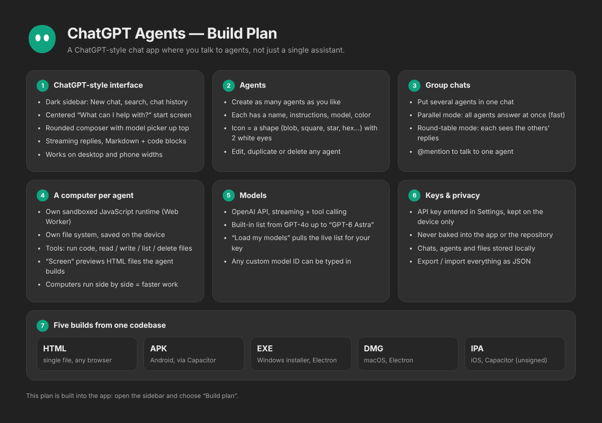

# ChatGPT Agents

A ChatGPT-style chat app built around **agents**. Create as many agents as you
like, each with its own instructions, model and computer, and talk to them one
at a time or together in group chats.

Independent app, not affiliated with OpenAI. It talks to the OpenAI API using
your own key.



## Features

- **ChatGPT-style interface**: dark sidebar with chat history and search, the
  "What can I help with?" start screen, the rounded composer, a model picker in
  the header, streaming Markdown replies with code blocks, and copy/regenerate.
  Works on phone screens too.
- **Agents**: name, instructions, model, and an icon made of a shape (blob,
  circle, square, triangle, star, hexagon, diamond, cloud) in one of ten colours
  with two white eyes. You can create, edit, duplicate and delete agents.
- **Group chats**: put any agents in a chat.
  - *Parallel* (default): every agent answers at the same time, which is the
    fast mode.
  - *Round-table*: agents answer one after another, and each one reads the
    replies before it.
  - Type `@Name` to ask just one agent.
- **A computer for every agent**: each agent gets its own sandboxed JavaScript
  runtime (a separate Web Worker) and its own file system, saved on the
  device. Agents have these tools: `run_javascript`, `write_file`, `read_file`,
  `list_files`, `delete_file`, `show_on_screen` (renders an HTML file the agent
  built, live and clickable) and `fetch_url`. Open **Computers** in the header
  to see each agent's screen, files and terminal, or to type code into the
  terminal yourself. In a parallel group chat the computers all run at once.
- **Models**: GPT-4o, GPT-4o mini, GPT-4.1, GPT-4.1 mini, o3, o4-mini, GPT-5,
  GPT-5 mini, GPT-5 nano and **GPT-6 Astra**. *Settings → Load my models*
  adds every chat model your key can actually use, and you can type in any
  custom model ID. A model your key doesn't have returns a clear error in the
  chat.
- **Build plan**: the plan screenshot is built into the app (sidebar →
  *Build plan*).
- **Privacy**: the API key, chats, agents and files live in the device's local
  storage. *Export all* writes a JSON backup without the key.

## API key

The key is **not** built into any of the apps or into this repository. If it
were, anyone who downloaded the app could pull it out and spend your credit.
Paste it in **Settings** on first launch.

## Builds

| Build | Made by | Output |
|---|---|---|
| HTML | `python3 build.py` | `dist/chatgpt-agents.html` (one self-contained file) |
| EXE | Electron + NSIS (`electron/`) | `ChatGPT-Agents-Setup-1.0.0.exe` |
| DMG | Electron (`electron/`), ad-hoc signed | `ChatGPT-Agents-1.0.0-arm64.dmg`, `-x64.dmg` |
| APK | Capacitor (`mobile/`) | `ChatGPT-Agents-1.0.0.apk` |
| IPA | Capacitor (`mobile/`), unsigned | `ChatGPT-Agents-1.0.0.ipa` |

`.github/workflows/agents-build.yml` builds all five on GitHub's Windows,
macOS and Linux runners whenever `agents/` changes, and publishes them as the
`agents-v1.0.0` release. Run it by hand from the Actions tab with
*Run workflow*.

Signing: the EXE and DMGs aren't signed with a paid certificate, so Windows
SmartScreen and macOS Gatekeeper will ask you to confirm the first time. The
IPA is unsigned because Apple only lets signed apps onto an iPhone. AltStore
or Sideloadly can sign it with a free Apple ID, or you can use a developer
certificate.

## Layout

```
agents/
  src/index.html      the whole app (HTML + CSS + JS, no dependencies)
  plan/plan.html      the build plan; plan.png is its screenshot
  build.py            inlines plan.png -> dist/chatgpt-agents.html
  assets/             app icon (png, ico) and logo for mobile icons
  electron/           desktop shell + electron-builder config
  mobile/             Capacitor config for Android / iOS
  test/verify.js      browser test against a mocked OpenAI API
```

## Testing

`node test/verify.js` drives the built HTML in headless Chromium against a
mocked OpenAI API. It runs 26 checks, covering:

- streaming and Markdown rendering
- the key prompt
- creating an agent
- a four-agent parallel group chat
- tool calls on an agent's computer, and the screen rendering and responding
  to clicks
- separate computers per agent
- the terminal
- `@mention` routing
- the built-in plan image
- persistence across reload
- the GPT-6 Astra entry
- phone layout
- no page errors
